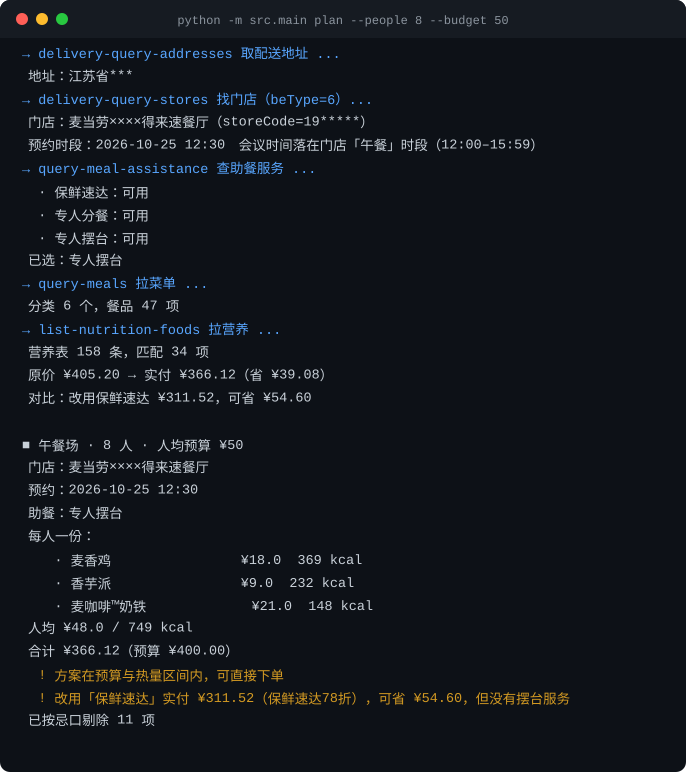

# 麦会点 · 会议室团餐管家

> 开会最烦的不是议题，是「中午吃什么」。
> 说一句「下午 3 点，8 个人，人均 40，两个人不吃牛肉」，它把菜单、热量、优惠券、分摊账单全算好，附一张 Excel，等你点确认。

基于 **麦当劳中国 MCP** 构建的团餐决策 Agent。输入一场会议的人数、预算、时长、忌口，输出一份可直接下单的点餐方案 —— 不只是"推荐套餐"，而是把**助餐服务档位与折扣、营养约束、满减券择优、AA 分摊**这四件最麻烦的事一次性算清。

> 省钱的真正大头不是凑券，是选对服务档位。同一份 8 人方案：专人摆台实付 ¥290（省 9.4%），改选保鲜速达实付 ¥234.60（省 26.7%），一次差 ¥55.40。工具把这个价差直接摆在你面前。

> **不想装 Python、不想配 Token？网页版点开就能试：**
> <https://mcd-meal-butler.app.workbuddy.host/?sharecode=WNTH7QJ45Y>
> （零依赖单文件，填完参数直接出餐单 + 预算体检 + 四张表 Excel）

> 本项目参加「WorkBuddy 1024 造物挑战」与掘金「1024·新饭碗计划」。
> 如果这个思路对你有用，点个 ⭐ Star 就是最好的支持。



---

## 目标用户

- **行政 / HR**：每周要订会务餐，反复在群里问「有没有人不吃辣」「谁不吃牛」
- **项目组 leader**：复盘会、评审会、加班餐，预算卡死但人数浮动
- **创业团队**：没有专职行政，订餐这事落在谁头上谁头疼

核心痛点不是"不知道麦当劳有什么"，而是**众口难调 + 预算对不上 + 报销要凭据**。

---

## 它到底做了什么

一句话：**把"问一圈人 → 翻菜单 → 心算总价 → 找券 → 拼单 → 报账"这条链路压成一次对话。**

| 环节 | 人工做法 | 麦会点 |
|---|---|---|
| 摸清需求 | 群里挨个问忌口 | 一次输入，转成结构化约束 |
| 选门店 | 搜地图，不知道能不能送 | `delivery-query-stores` 按地址查**团餐**门店 |
| 判资质 | 不知道有没有团餐、能不能摆台 | `query-meal-assistance` 查助餐服务，含 4 小时预约门槛 |
| 挑餐品 | 翻菜单，套餐内容看不全 | `query-meals` 拉全量菜单与配料标签 |
| 控热量 | 凭感觉 | `list-nutrition-foods` 按人均热量区间约束 |
| 算总价 | 计算器手算 | `calculate-price` 官方计价，含配送费与优惠 |
| 报账 | 手写 Excel | 自动生成点餐表 + AA 分摊 + 营养汇总 |
| 下单 | 打开 App 重输一遍 | `create-order` 确认后直接下单 |

### 和"套餐推荐助手"的区别

市面上的同类作品大多停在「按预算推一个套餐」。麦会点的差异在四点：

1. **把「助餐服务」当成一等公民**：团餐不是把餐送到楼下就完事。`query-meal-assistance` 返回三档服务——保鲜速达、专人分餐、专人摆台，而后两档**要提前 4 小时预约**。所以工具会根据会议时间自动判断能不能解锁摆台，不能的话明确告诉你差多久。这一点几乎没有同类作品用到。
2. **约束是硬的，不是软的**：忌口、过敏、人均热量上下限作为硬约束参与组合求解，不满足就换品，而不是"建议少吃"。过滤依据是菜单里的配料标签（「牛肉」「100%纯牛肉」「鸡肉」），比按名字猜准得多。
3. **价格只信官方**：所有金额以 `calculate-price` 的返回为准，本地估算只用于筛选。菜单里混着不可售的品项，计价会整单报错——工具会逐项定位、剔除、重解，而不是给你一个算得漂亮但下不了单的方案。
4. **交付物是 Excel，不是一段话**：报销要凭据、分摊要明细，所以最终产物是一份能直接发群里的点餐表。

---

## 安装

```bash
git clone https://github.com/zhhqin866/mcd-meeting-butler.git
cd mcd-meeting-butler

python -m venv .venv
source .venv/bin/activate        # Windows: .venv\Scripts\activate
pip install -r requirements.txt
```

### 配置 MCP Token

1. 打开 <https://open.mcd.cn/mcp>（**必须带 `/mcp`**——`open.mcd.cn` 是商户合作平台，不是这个）
2. 右上角【登录】→ 用麦当劳 APP / 微信 / 支付宝扫屏幕二维码 → 手机上确认
3. 登录后右上角变成【控制台】，点它 →【激活】→ 同意服务协议 → 复制 Token
4. 写入环境变量（**不要写进代码，也不要提交到仓库**）

```bash
export MCD_MCP_TOKEN="你的 Token"        # Windows: set MCD_MCP_TOKEN=...
```

不想手动配的话，跑这个脚本，粘贴一次 Token 就行（输入不回显，只写本地文件）：

```bash
python tools/setup_token.py
```

---

## 使用示例

### 1. 先探活，确认 Token 与工具列表

```bash
python -m src.main probe
```

输出当前 Token 可用的 Tool 列表。**第一次跑请先执行这一步**，用于确认权限范围。

### 2. 出一份会议点餐方案

```bash
python -m src.main plan \
  --people 8 \
  --budget 50 \
  --start "2026-10-25 12:30" \
  --duration 120 \
  --avoid 牛肉,花生 \
  --need-coffee \
  --out 点餐方案.xlsx
```

实际执行链路（全部为真实调用，参数经实测校准）：

```
delivery-query-addresses()
  → delivery-query-stores(addressId, beType=6)          查团餐门店，拿 storeCode + beCode
  → 时段对齐：会议时间落到门店的「午餐 / 下午茶 / 夜市」哪一档
  → query-meal-assistance(storeCode, beType=6, orderType=2, beCode, reservationDate)
                                                        查助餐服务，选服务等级最高的一档
  → query-meals(storeCode, orderType=2, beType=6, beCode)
                                                        菜单 = categories(code+标签) + meals(名称+价格)
  → list-nutrition-foods()                              营养表，按忌口与热量区间过滤
  → 本地组合求解                                          主食 × 小食 × 饮品穷举 + 代价排序
  → calculate-price(..., gmServiceCode, reservationDate) 官方计价；遇售罄自动定位并重解
  → 输出 Excel（4 个 Sheet）
```

终端会打印每一步的真实返回摘要。下面是 2026-10-24 的一次真实运行（8 人 / 人均 ¥50 / 明天 12:30 / 不吃牛肉 + 花生过敏 / 需要咖啡）：

```
→ delivery-query-addresses 取配送地址 ...
  地址：江苏省***
→ delivery-query-stores 找门店（beType=6）...
  门店：麦当劳××××得来速餐厅（storeCode=19*****）
  预约时段：2026-10-25 12:30　会议时间落在门店「午餐」时段（12:00–15:59）
→ query-meal-assistance 查助餐服务 ...
  · 保鲜速达：可用
  · 专人分餐：可用
  · 专人摆台：可用
  已选：专人摆台
→ query-meals 拉菜单 ...
  分类 6 个，餐品 47 项
→ list-nutrition-foods 拉营养 ...
  营养表 158 条，匹配 34 项
  原价 ¥405.20 → 实付 ¥366.12（省 ¥39.08）
  对比：改用保鲜速达 ¥311.52，可省 ¥54.60

■ 午餐场 · 8 人 · 人均预算 ¥50
  门店：麦当劳××××得来速餐厅
  预约：2026-10-25 12:30
  助餐：专人摆台
  每人一份：
    · 麦香鸡                ¥18.0  369 kcal
    · 香芋派                ¥9.0   232 kcal
    · 麦咖啡™奶铁            ¥21.0  148 kcal
  人均 ¥48.0 / 749 kcal
  合计 ¥366.12（预算 ¥400.00）
  ! 方案在预算与热量区间内，可直接下单
  ! 改用「保鲜速达」实付 ¥311.52（保鲜速达78折），可省 ¥54.60，但没有摆台服务
  已按忌口剔除 11 项
```

注意最后两行——**它不只给方案，还把「省服务费」和「保服务」的代价摆在一起让你选**。这是团餐场景里真正难的那一步。

预算收紧到人均 ¥40 时，它会给出另一套诚实的答案：

```
  人均 ¥33.5 / 754 kcal
  ! 预算内放不下咖啡（门店最低 ¥19.0），人均提到 ¥52 左右可加一杯
```

不硬凑、不假装达标，而是告诉你差多少、加多少钱能补上。

终端会打印方案摘要，同时生成 `点餐方案.xlsx`：

- **Sheet 1 点餐总表**：每人的主食 / 小食 / 饮品 / 热量 / 单价
- **Sheet 2 分摊账单**：总额、人均、AA 到分
- **Sheet 3 营养汇总**：总热量、蛋白质、钠，标注是否超出设定区间
- **Sheet 4 省钱明细**：用券前后对比，省了多少

### 3. 确认后下单

```bash
python -m src.main order --plan 点餐方案.json --confirm
```

不加 `--confirm` 只做预演，不会产生真实订单。

### 4. 没有 Token 也能跑通演示

```bash
python -m src.main plan --people 8 --budget 40 --start "2026-10-24 15:00" --avoid 牛肉,花生 --mock --out demo.xlsx
```

`--mock` 使用 `examples/mock_menu.json` 里的静态数据，用于录制演示视频与跑测试。

### 5. 网页版（零依赖，双击就能开）

**在线体验（推荐，什么都不用装）**：<https://mcd-meal-butler.app.workbuddy.host/?sharecode=WNTH7QJ45Y>

本地打开：

```bash
# 不需要 Python、不需要 Token、不需要联网
open web/index.html          # Windows: start web\index.html
```

左侧填人数、人均预算、开会时间、忌口，右侧直接出每人餐单、预算与热量体检、剔除清单、账单分摊，并可一键导出四张 Sheet 的 Excel。网页版内置一份脱敏菜单样本，用于演示完整决策链路；逻辑与 CLI 共用同一套约束求解规则（组合穷举 + 代价函数）。

---

## 参数说明

| 参数 | 说明 | 默认 |
|---|---|---|
| `--people` | 会议人数 | 必填 |
| `--budget` | 人均预算（元） | 必填 |
| `--start` | 会议时间，如 `"2026-10-24 18:00"` | 当前时间 |
| `--duration` | 会议时长（分钟） | 120 |
| `--address` | 用于匹配账号下已保存的配送地址，留空取第一条 | 第一条 |
| `--avoid` | 忌口 / 过敏原，逗号分隔 | 无 |
| `--need-coffee` | 需要咖啡提神（下午场建议开） | 关 |
| `--max-kcal` | 人均热量上限 | 按门店时段自动推断 |
| `--be-type` | `6`=企业团餐，`2`=麦乐送 | `6` |
| `--mock` | 使用本地静态数据 | 关 |
| `--out` | Excel 输出路径 | `点餐方案.xlsx` |

---

## 项目结构

```
mcd-meeting-butler/
├── README.md
├── CONTEST_DECLARATION.md      # 参赛声明（官方原文，勿改）
├── MCP_INTEGRATION.md          # MCP 接入说明（官方要求）
├── workbuddy.md                # WorkBuddy 开发对话记录
├── requirements.txt
├── src/
│   ├── main.py                 # CLI 入口：probe / plan / order
│   ├── mcd_client.py           # Streamable HTTP MCP 客户端（含 SSE 解析、拆信封）
│   ├── catalog.py              # 取数：地址 → 门店 → 助餐服务 → 菜单 → 计价
│   ├── nutrition.py            # 营养紧凑表解析
│   ├── planner.py              # 约束求解与选品逻辑
│   └── report.py               # Excel 报表生成
├── web/
│   └── index.html              # 零依赖网页版，双击即用
├── tools/
│   ├── setup_token.py          # 本地 Token 配置（输入不回显）
│   └── make_demo_svg.py        # 把一次真实运行的终端输出渲染成 SVG
├── examples/
│   ├── meeting_input.json
│   └── mock_menu.json
└── docs/
    ├── demo.md                 # 演示脚本与旁白
    └── demo-run.svg            # README 顶部那张图（内容是真实终端输出）
```

---

## 设计取舍

- **为什么不直接让大模型挑？** 预算、忌口、热量是硬约束，大模型容易在"差不多"上妥协。所以选品交给确定性算法（主食 × 小食 × 饮品穷举 + 代价函数排序），大模型只负责把自然语言转成参数、把结果讲成人话。代价函数里超预算的权重最高，其次是热量偏离目标区间，再次是「要咖啡却没给咖啡」。
- **为什么最终产物是 Excel？** 因为真实场景里这张表要发群、要报销、要留档。一段聊天记录解决不了这个需求。
- **为什么先查助餐服务？** 团餐和普通取餐的服务能力、起订量、配送方式都不同；而且专人摆台要提前 4 小时预约，不先判断，用户会以为「点了就有」。价格也一样——服务码不同，折扣也不同。
- **为什么预算不放进代价函数？** 因为它是硬上限，不是可权衡的一项。求解器先按 `人均价格 ≤ 预算` 硬过滤，只在可行域里评分；可行域为空时明确返回「没有满足全部条件的方案」，再给一份超支最少的备选。自动替用户放松预算，等于把决策成本又推回去。

---

## 已知限制

- 各门店餐品供应状态以 `query-meals` 实时返回为准，本工具不做缓存
- 营养数据来自 `list-nutrition-foods`，仅供搭配参考，不构成营养建议
- 单 Token 限流 600 次/分钟，批量场景已做请求节流

---

## 输出脱敏

终端、日志、文档里出现的地址与门店名**默认只到省级**，门店编码只留前两位：

```
地址：江苏省***
门店：麦当劳××××得来速餐厅（storeCode=19*****）
```

原因是门店名本身就是定位信息——「麦当劳××市××数码城得来速餐厅」这种名字，城市 + 商场名足以反推办公地点，而这个信息对读者毫无价值。地址同理：团餐场景里「哪个省」已经足够解释时段与菜单差异，再往下精确到市、区只会暴露真实位置。

需要调试时可以用环境变量放宽：

```bash
export MCD_MASK_LEVEL=city    # 留到市/区
export MCD_MASK_LEVEL=none    # 完全不脱敏（仅本机使用）
```

一个例外：**导出的 Excel 里保留真实门店名**——报账需要它。终端会在生成报表后提示这一点。

---

## 免责声明

本项目为「麦当劳程序员节创意开发大赛」参赛作品，由参赛者独立开发，**非麦当劳官方产品**。餐品信息、价格及供应状态以麦当劳官方渠道实时结果为准。

---

## License

MIT
